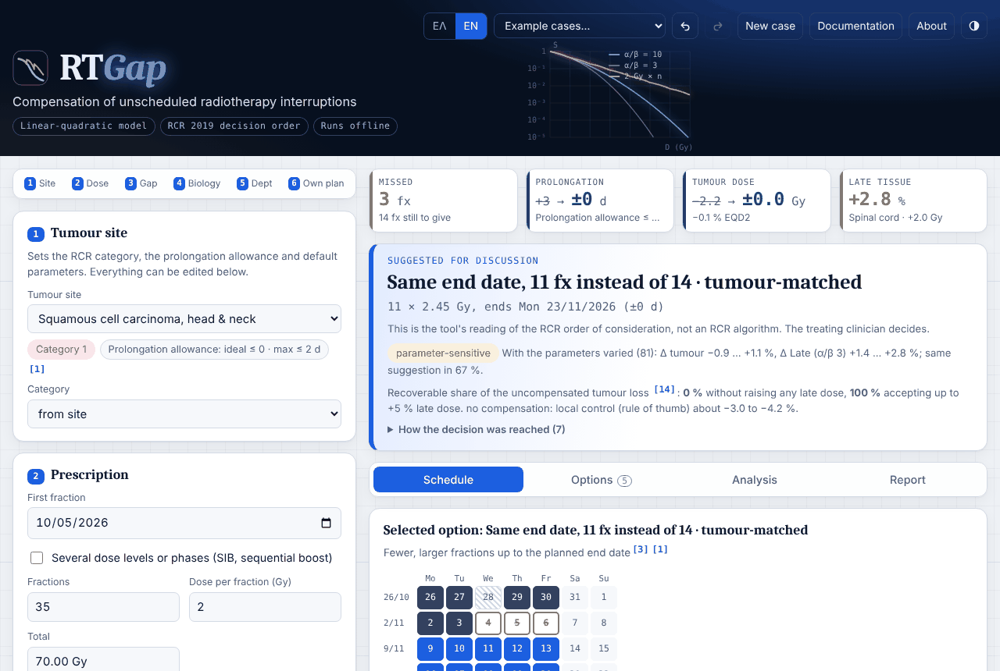

# RTGap

**Compensation of unscheduled radiotherapy interruptions.** RTGap places every
compensation method of the RCR guidance on the real treatment calendar,
evaluates it with the linear-quadratic model, and shows what each one costs the
tumour and the normal tissues, which options the rules exclude and why.

**Open the app: <https://konsvasilopoulos.github.io/RTGap/>**
(installable as an app; or download `dist/index.html` and open it in any
browser, it works offline).



> Decision support for research and education, **not a medical device**. All
> parameters and every modified schedule must be checked by the treating team.
> See [intended use and limitations](docs/INTENDED_USE.md).

## What it does

- **RCR decision order** for 26 tumour sites (categories 1–3), 2019 edition or
  the 5th edition draft, with the source beside every rule.
- **Real calendar**: weekends, Greek public holidays, machine downtime,
  chemotherapy days, twice-daily fractions.
- **Every option with its reason**: weekend, BID, fewer and larger fractions,
  prolongation, extra fractions; excluded options stay visible with the rule
  that excluded them.
- **Whole treatment history**: several interruptions, catch-up fractions
  already given, an earlier change of plan, dose errors (Joiner correction).
- **Dose levels and brachytherapy**: SIB, sequential boost, HDR fractions.
- **How robust is it**: 81-combination parameter sweep, resume-date scenarios,
  trade-off map, check-by-hand worksheet.
- **Before the start**: closed days inside the planned course, what they
  cost, and which start day avoids them.
- **LQ or LQ-L**: optional linear-quadratic-linear model for large fractions.
- **Machine outage triage**: apply an outage to all saved cases at once and
  get the patients in order of priority, with the extra sessions needed.
- **Audit and patient lists**: import patients from CSV; audit table of the
  saved cases per RCR category; user guide inside the app.
- **For the department**: protocol file with local constraints and values,
  PDF report in Greek or English, treatment sheet for radiographers, link to
  share a case, cases saved on the device.
- **Private**: one file, no server. Nothing leaves the device.

## Validation
Live summary of every check: [validation page](https://konsvasilopoulos.github.io/RTGap/validation.html).


- 75 Python tests reproduce published worked examples (Basic Clinical
  Radiobiology ch. 9; RCR 2019 Appendix B).
- The engine exists twice (Python and JavaScript); the two agree on 928
  randomised cases, 6136 schedules.
- Plain LQ results agree with RadComp on 9 schedules
  ([benchmark](validation/benchmark.md)).
- The web app runs a self-test of 15 published values on every device.

Still open: retrospective comparison with real cases and an independent second
check ([validation/](validation/README.md)).

## Python package

```bash
pip install -e .
rtgap plan examples/hn_machine_breakdown.yaml --html report.html
rtgap sites            # site library
pytest                 # tests
```

The case and protocol file formats, the model and the command line are
described in the [reference](docs/REFERENCE.md). Changes per version are in the
[changelog](CHANGELOG.md).

## Repository

| Path | Content |
|---|---|
| `dist/index.html` | the web app, one file (`dist/` also holds the presentation page and the files that make it installable) |
| `web/` | sources of the web app and the Python-vs-JavaScript cross-validation |
| `rtgap/` | Python reference implementation and site library |
| `tests/`, `validation/` | tests, benchmark, template for retrospective cases |
| `examples/` | example cases and a department protocol |
| `docs/` | reference, intended use and limitations |

## Citation and licence

Developed by **Konstantinos Vasilopoulos, PhD Candidate**. Please cite with
[CITATION.cff](CITATION.cff).

[GNU AGPL-3.0-or-later](LICENSE); commercial licences are available from the
author ([COMMERCIAL.md](COMMERCIAL.md)).
